# Shadow Fist 影拳

Файтинг в стиле кунг-фу и аниме от третьего лица. Выбери героя и выходи против ронинов: они идут один за другим, пока ты
не упадёшь. Рекорд — сколько противников ты победил за один забег.

**Десять героев:** странствующий ронин Wanderer 旅人, молодой монах с повязкой на глазах Young Monk 若僧, старый мастер с белым
огнём в глазах Old Master 老師, куноити в стальной маске Kunoichi くノ一, монах-сумоист Sumo 力士, тигр Raja 虎王, ледяной боец
Iceberg 氷山, самурай зимы Winter Samurai 冬侍, огненный Dragon Warrior 炎龍 (его суперудар — огромная голова дракона, которая
проглатывает противника) и король обезьян Monkey King 美猴王. У каждого два своих скилла, свой суперудар и своя подмена.

**Обучение 修行** (с версии 1.4.6): 25 уроков по шагам — от блока и парирования до тройного прыжка в небо, Meteor и серий в воздухе.

**ENDLESS WAR 無尽** (с версии 1.4.5): бесконечные волны шиноби — несколько на поле сразу, каждая 5-я волна — босс-ронин со своими
скиллами, между волнами — выбор усиления. Можно вдвоём по сети.

**Онлайн:** сражайся с другом один на один или вместе против волн ENDLESS WAR. Создай комнату, отправь другу код, выберите бойцов —
и в бой.

**Четыре карты, и на всех всё рушится:**
- **Арена** под открытым небом. По бокам лестницы ведут на две малые арены, повсюду ограды, беседки, колокольня и каменные
  статуи-стражи: от удара статуя рассыпается на куски.
- **Пагода-храм** посреди большого двора со статуями и постройками. Внизу буддийский храм со статуей Будды (в него со двора ведут
  распахнутые двери), наверху два этажа пагоды с открытыми балконами. Бой начинается на третьем этаже. Удар Falling star проламывает
  пол: падаете этажом ниже, до самого храма. Сломай перила — и сбрось противника с балкона во двор. Храм разрушается целиком,
  по крышам можно ходить.
- **Водопад:** бой на мокрой плите и по мелководью, тории, мельница, бамбук, а за завесой воды — пещера с алтарём.
- **Лес Тэнгу:** низина в скалах, туман, бамбук, сакура и японские сосны, красные и деревянные тории (рушатся по частям), белая
  лестница к храму. Прижми противника к огромному валуну, и валун разлетится на сотню кусков, а комбо продолжится.

## Обучение 修行

Режим **TUTORIAL** в меню (ЛКМ по FIGHT). 25 уроков по порядку, все механики: бег и камера, руки и ноги, Crane flight, блок,
парирование, уворот, Wind step, двойные прыжки, удары в прыжке, серия в воздухе ×3 и её финалы, Rising palm, рывок в воздухе,
небо (третий прыжок) и Dash, Meteor, Falcon strike и Comet heel, резко вниз, стена, подъём, air recovery, скиллы, подмена,
суперудар, вызов — и в конце свободный бой. Против тебя ронин-манекен: он стоит, бьёт, сбивает или подбрасывает — что нужно уроку.
Цели засчитываются сами, клавиши в тексте — твои, даже переназначенные. F2 — следующий урок, F3 — назад, пройденное запоминается.

Язык всей игры — **SETTINGS → LANGUAGE**: English (по умолчанию) или Русский. С версии 1.4.7 переводится всё: меню, описания героев, скиллов и суперударов, карты, комната онлайна, усиления ENDLESS WAR, обучение, пауза.

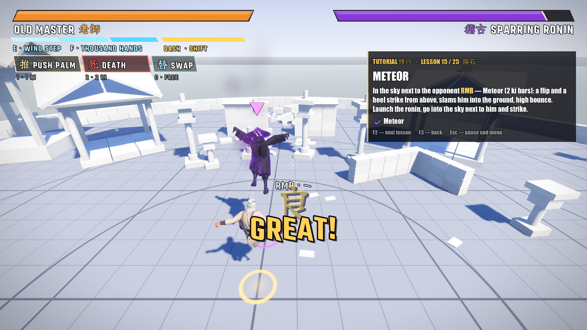

## ENDLESS WAR 無尽

В меню первая строка — режим: **ЛКМ по FIGHT** (или ←→ на нём) листает **1 VS 1 → ENDLESS WAR → TUTORIAL**, **Enter** — сразу в бой.

- **Толпа шиноби.** Несколько врагов на поле, атакуют по очереди, остальные кружат и ждут момента; чем дальше — тем их больше.
  Чёрные бьются врукопашную, серые метают сюрикены издалека, красные — быстрые, с рывками и ударами в прыжке.
- **Цель — сама**, по направлению взгляда и движения; удар задевает и соседей. В толпе герой сильнее: Wind step без ци, подмена
  раз в 4 секунды, урон ×1,6, комбо без ограничений. Meteor, Falcon strike и суперудары расшвыривают всех вокруг.
- **Боссы — каждая 5-я волна:** Shadow Ronin (теневой шаг за спину, двойники), Crimson Ronin (берсерк, серия сквозь блок, таран),
  Frost Ronin (ледяная волна, шипы из-под земли, ледяная броня), Golden Master (золотой щит, призыв отряда, «Тысяча ладоней»).
  Потом по кругу, сильнее.
- **Усиления** после каждой волны — одно из трёх (1 / 2 / 3 или мышью): здоровье, урон, ци, подмена, поджог, заморозка, молния
  по соседям, вампиризм, взрыв повергнутого.
- **Очки и рекорд:** урон, нокауты, волны, волна без урона, боссы. Лучшая волна и счёт карты — в меню.
- **Вдвоём по сети:** FIGHT ONLINE → комната → создатель комнаты жмёт **M** — «CO-OP ENDLESS WAR». Врагов больше, своих не задеть;
  павшего поднимает напарник — встать рядом на 3 секунды.

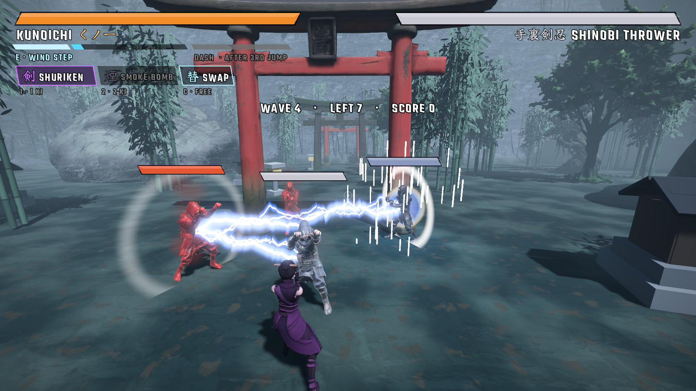

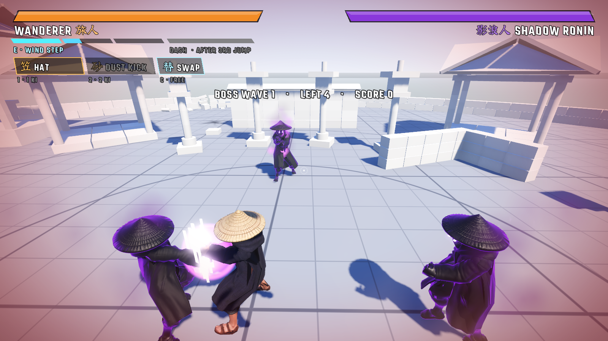

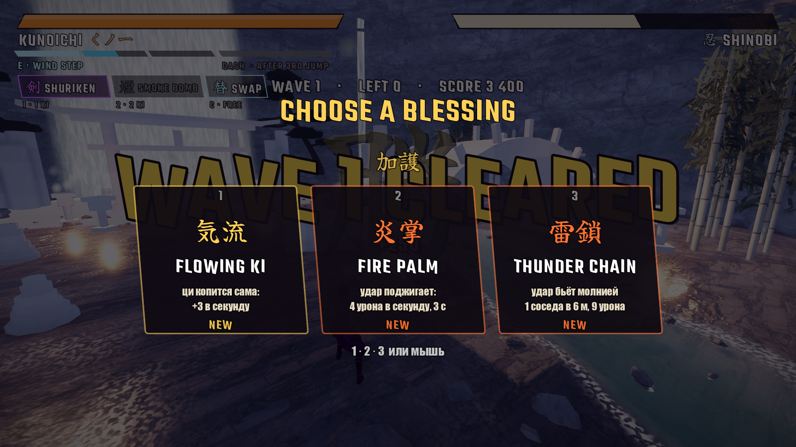

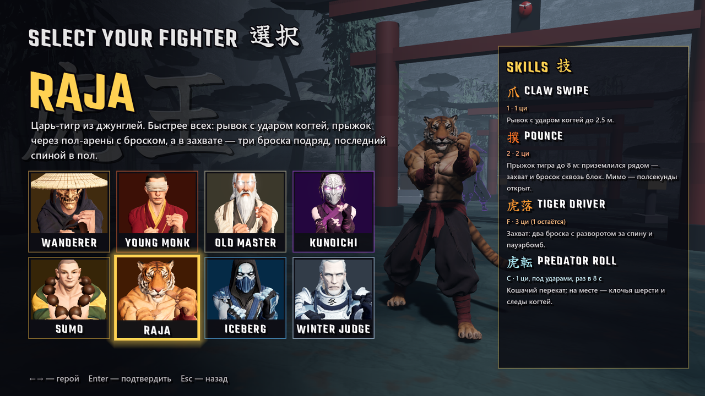

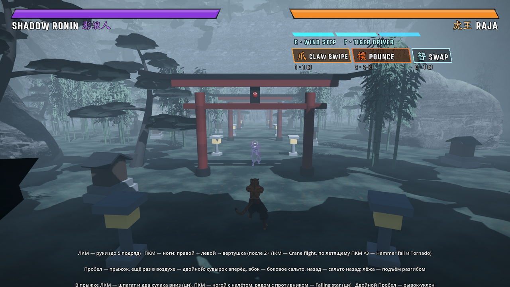

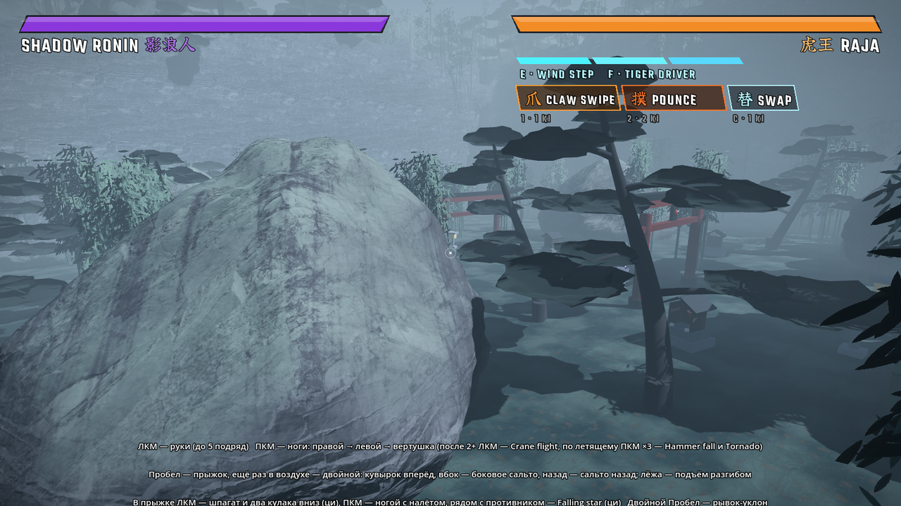

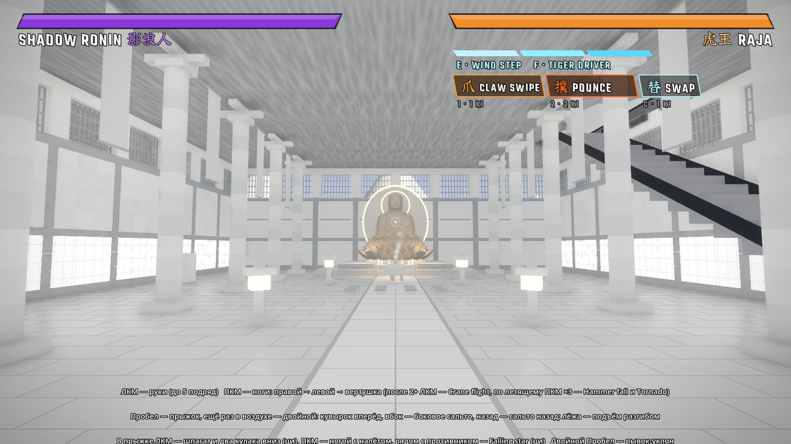

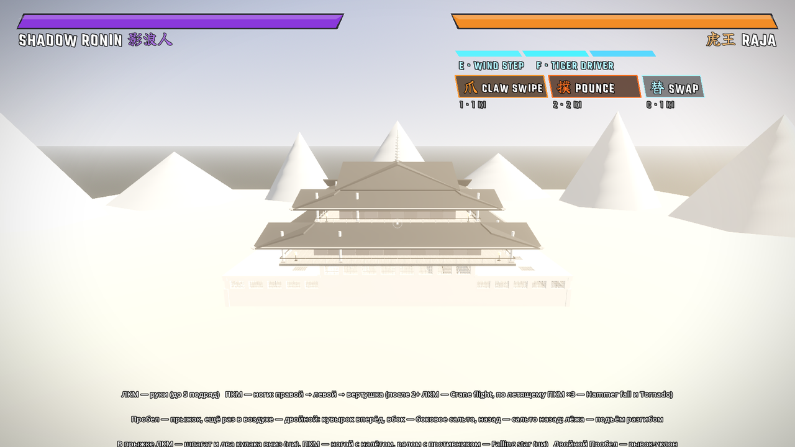

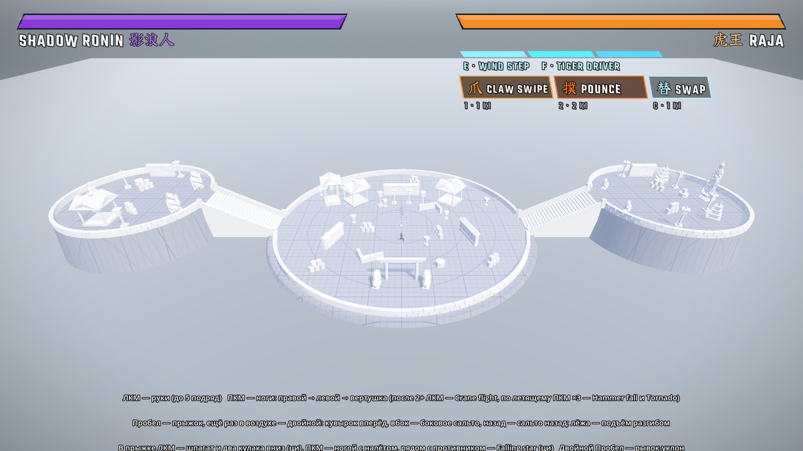

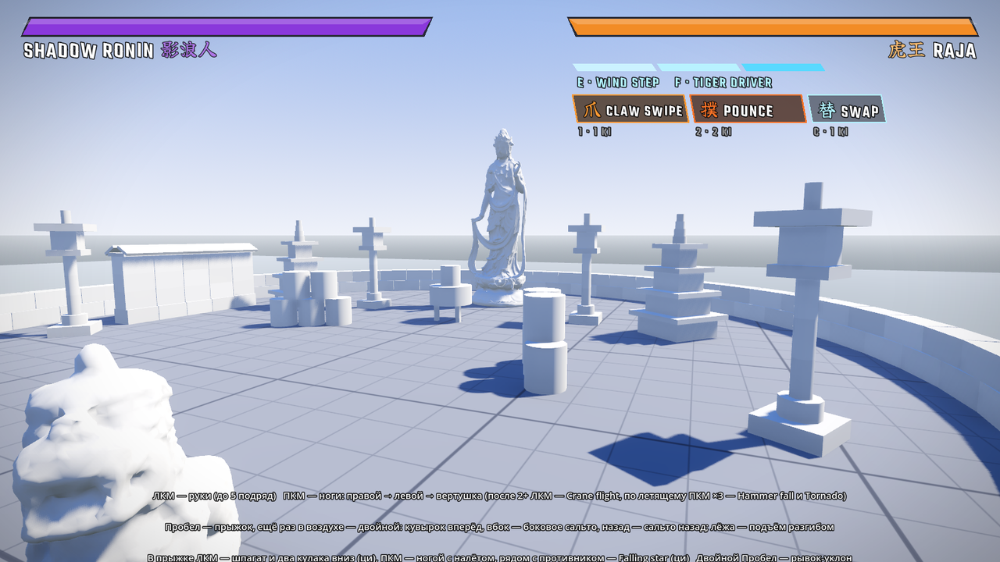

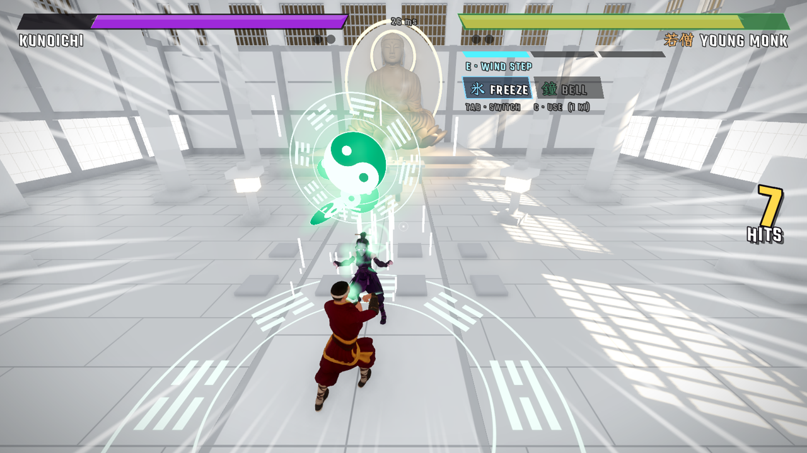

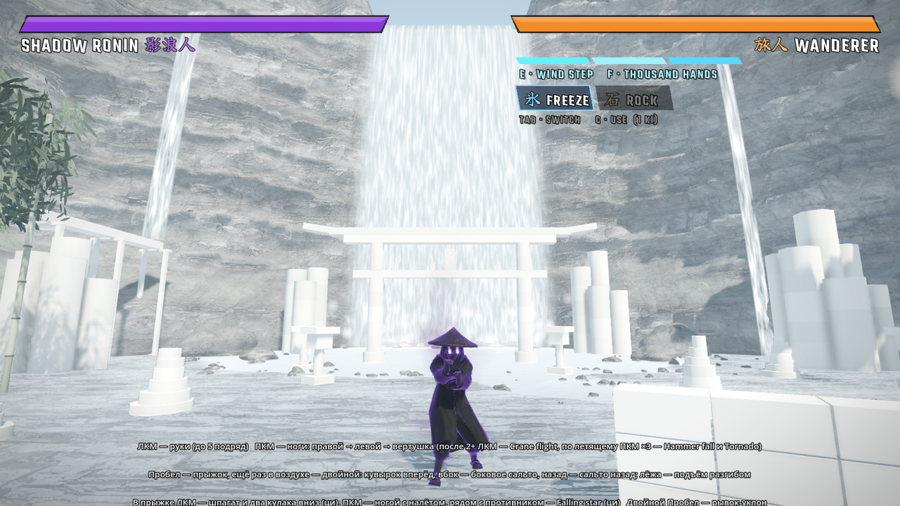

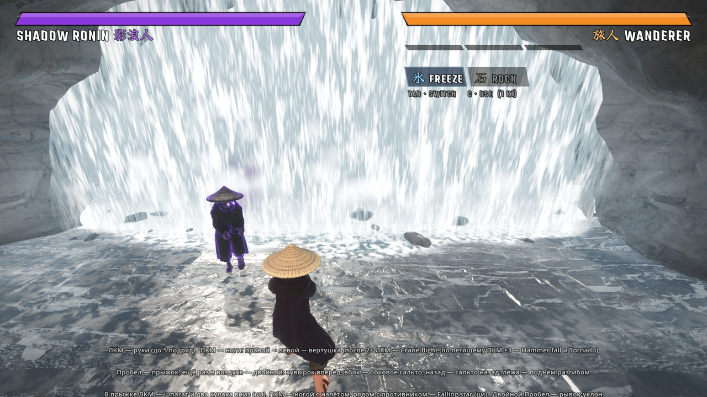

## Как запустить на Windows

1. Открой страницу **[Releases](../../releases/latest)** и скачай **`ShadowFist.exe`**.
2. Запусти его. Устанавливать ничего не нужно.
3. Windows может показать «Система Windows защитила ваш компьютер», потому что exe не подписан. Нажми **«Подробнее» →
   «Выполнить в любом случае»**.

Нужно: Windows 10 или 11 (64 бит) и видеокарта с поддержкой Vulkan (любая GeForce или Radeon последних лет).
Рекорды и настройки сохраняются в `%APPDATA%\Godot\app_userdata\Shadow Fist\`.

## Обновления

С версии 1.4 игру не нужно скачивать заново. С 1.4.6 на плашке обновления видно, что в нём нового, а после обновления один раз показывается окно «Что нового». При запуске она сама проверяет, вышло ли обновление: в главном меню появится
плашка с размером обновления. Нажми **«Обновить»**: игра скачает только изменения (обычно от сотен килобайт до нескольких
мегабайт), потом **«Перезапустить»**. Номер версии — в правом нижнем углу меню.

Иногда выходит новая полная версия: тогда плашка предложит открыть страницу загрузки.
С версии 1.3 и старше на 1.4 нужно перейти один раз вручную: скачать `ShadowFist.exe` заново.

## Как запустить на Mac

**Бета:** версию 1.4 на Mac не запускали ни разу, возможны баги. Прошлую версию проверяли только на тестовых машинах.

1. Открой страницу **[Releases](../../releases/latest)** и скачай **`ShadowFist-macOS.zip`**.
2. Распакуй архив и перетащи **Shadow Fist** в папку «Программы».
3. Приложение не заверено в Apple, поэтому при первом запуске Mac его заблокирует. Открой Терминал и выполни:

   ```
   xattr -dr com.apple.quarantine "/Applications/Shadow Fist.app"
   ```

4. Запусти игру. Если Mac всё равно не пускает: «Системные настройки» → «Конфиденциальность и безопасность» →
   внизу **«Всё равно открыть»**.

Нужно: Mac на Apple Silicon (M1 и новее) с macOS 13 или новее. Для игры нужна мышь с двумя кнопками или правый клик на трекпаде.
На Mac с процессором Intel игра не проверялась: она может не запуститься.
На Mac в храме нет дымки благовоний, в остальном игра та же. Обновления из игры на Mac не проверялись. Играть онлайн можно между Mac и Windows.

## Как играть с другом

1. Оба скачивают игру для Windows или для Mac и обновляют её до последней версии. Если версии разные, в комнате появится подсказка,
   и бой не начнётся.
2. Один открывает **FIGHT ONLINE → Создать комнату** и отправляет другу код из пяти букв.
3. Второй открывает **FIGHT ONLINE**, вводит код и нажимает **Подключиться**.
4. Выберите бойцов: ←→ — герой, Enter — готов. Карту меняет создатель комнаты клавишей Tab, режим — клавишей **M**:
   один на один или **CO-OP ENDLESS WAR** — вместе против волн.
5. Бой один на один идёт до двух побед, кооператив — пока не падут оба. Потом вы снова в комнате и можно сыграть ещё.

Комнату может создать любой из вас. Ничего настраивать не нужно, нужен только интернет.
Вверху экрана в бою видно, как идёт связь: `UDP 23 ms ±4 0%` — пинг, разброс задержки и потери пакетов.

Играйте с разных компьютеров: две копии игры на одном ПК могут зависнуть.

## Управление

| Клавиша | Что делает |
|---|---|
| WASD, мышь | бег (включён всегда) и взгляд; зажатый Alt — шаг |
| Shift | рывок: на земле — уворот, в воздухе — к противнику, в небе — Dash, пока держишь |
| ЛКМ | удары руками, до 5 подряд |
| ПКМ | удары ногами: правой → левой → вертушка. После 2+ ударов рукой — Crane flight. По летящему противнику ПКМ ×3 — Sky kick → Hammer fall → финал (высоко — Skyfall, у стены — Wall crash, низко — Tornado), один раз за полёт. Что сделает ПКМ в воздухе — написано под прицелом |
| Пробел | прыжок; ещё раз в воздухе — двойной: кувырок вперёд, вбок — боковое сальто, назад — сальто назад; **третий — высоко, в небо**: там ПКМ — Meteor (2 деления ци) или без ци — Falcon strike, после попавшего Falcon ещё ПКМ — Comet heel. Зажатый в падении — парение. Лёжа — подъём разгибом. В прыжке ЛКМ — шпагат и два кулака вниз (1 деление ци), рядом с летящим противником — серия рук, после двух ударов — Rising palm; ПКМ — удар ногой с налётом, рядом с противником — Falling star (1 деление ци) |
| Alt | в воздухе — резко вниз (на земле — шаг) |
| E | Wind step — рывок к противнику с ударом (1 деление ци) |
| Q | блок; если поставить вовремя — парирование и ответный One Inch Punch |
| 1 / 2 | первый скилл героя (1 деление ци) / второй (2 деления). Какие у кого — на экране выбора героя, справа |
| C | подмена: только под ударами, раз в 8 секунд, бесплатно — на месте героя остаётся приманка, он сам появляется позади |
| F | суперудар, у каждого героя свой (3 деления ци, 1 деление остаётся, немного лечит) |
| T | вызов |
| Колёсико | приблизить / отдалить камеру |
| Esc | пауза: громкость, управление (переназначить клавиши), боты, наводка камеры, метка и тени в воздухе, выход в меню |
| F1 | показать / скрыть подсказку с приёмами |

Ци копится от попаданий, блоков, парирований и идеальных уклонов. Все кнопки можно переназначить в меню (CONTROLS) и прямо в бою — в паузе, пункт «Управление».
Громкость музыки, ударов, разрушений, голоса диктора и интерфейса — в меню SETTINGS и в паузе.

## Авторы

Игра — tensei888 (с помощью Claude). Модели героев — свои, сделаны в Tripo. Движок — [Godot](https://godotengine.org) 4.7.

- **Статуя Будды:** Yahoo! JAPAN, [«大仏（Buddha）3Dデータ»](https://www.thingiverse.com/thing:182082), лицензия
  [CC BY 4.0](https://creativecommons.org/licenses/by/4.0/). В игре изменены масштаб и сглаживание.
- **Статуи на арене** (сканы с Thingiverse; в игре упрощены, перекрашены в белый и расколоты на куски):
  - ta note, [«komainu_statue»](https://archive.org/details/thingiverse-5187762) — [CC BY 4.0](https://creativecommons.org/licenses/by/4.0/);
  - Hao Doan, [«HD Scan 3D Buddha Statue 01»](https://archive.org/details/thingiverse-2752226) — [CC BY 4.0](https://creativecommons.org/licenses/by/4.0/);
  - Asian Art Museum of San Francisco, [«The Bodhisattva Avalokiteshvara»](https://archive.org/details/thingiverse-74431) — [CC BY 4.0](https://creativecommons.org/licenses/by/4.0/);
  - Bali 3D, [«Drawapala, Bali Temple Guardian Statue»](https://archive.org/details/thingiverse-3363639) — [CC BY 4.0](https://creativecommons.org/licenses/by/4.0/), постамент срезан;
  - Toby Robb, [«Nepalese foo dog sculpture»](https://archive.org/details/thingiverse-3558269) — CC0.
- **Кисть для длани Будды:** Blender Studio, Dan Ulrich и др., Human Base Meshes (CC0). В игре переделана: срезана, упрощена,
  добавлены колесо дхармы и браслеты.
- **Голова дракона:** king arthur (jimjimjimmyjim), [Asian-style dragon](https://archive.org/details/thingiverse-4314911), лицензия
  [CC BY 4.0](https://creativecommons.org/licenses/by/4.0/). В игре вырезана из модели и упрощена.
- **Текстура камня** (водопад, лес Тэнгу): [Poly Haven](https://polyhaven.com/a/cliff_side), cliff_side (CC0).
- **Молния** (усиление THUNDER CHAIN): по мотивам шейдера pend00 [«Energy Beams»](https://godotshaders.com/shader/energy-beams/) (CC0).
- **Ледяные кристаллы:** ipoly3d, [LowPoly Crystals Pack](https://opengameart.org/content/lowpoly-crystals-pack) (CC0).
- **Анимации:**
  - mocapdata.com, Eyes, JAPAN Co. Ltd. — *This motion capture data is licensed by mocapdata.com, Eyes, JAPAN Co. Ltd.
    under the Creative Commons Attribution 2.1 Japan License. http://mocapdata.com/ (C) Copyright Eyes, JAPAN Co. Ltd.
    2008-2009.* Переделанные из этих записей клипы распространяются по той же лицензии
    ([CC BY-SA 2.1 JP](https://creativecommons.org/licenses/by-sa/2.1/jp/)).
  - [CMU Graphics Lab Motion Capture Database](http://mocap.cs.cmu.edu), в том числе запись тайцзи.
  - [Quaternius](https://quaternius.com), Universal Animation Library (CC0).
  - [Motifect](https://motifect.itch.io), Martial Arts, Combat, Fantasy & Magic Motion Packs.
- **Звуки, CC BY 3.0:**
  - CGEffex, «Punch, slap, n' kick»;
  - Michel Baradari, «2 High Quality Explosions»;
  - Blender Foundation, «rock_breaking» (Yo Frankie!).
- **Звуки, CC0:** Kenney (Impact Sounds, RPG Audio, Voiceover Pack: Fighter), artisticdude, Independent.nu, rubberduck,
  StarNinjas, pyranostudios, Jordan Irwin (AntumDeluge).
- **Музыка** (с [OpenGameArt](https://opengameart.org)):
  - neocrey, «Last Cyber Dance» (CC BY 3.0);
  - Matthew Pablo, «Wasteland Overdrive» (CC BY 3.0);
  - nene, «Boss Battle #6 Metal» (CC0);
  - Emma_MA, «Determined Pursuit» (CC0).
- **Чтение сутр** в музыке пагоды-храма (записи с Wikimedia Commons; в игре обработаны, под них добавлены бурдон, тайко и колокол):
  - Head Priest Yodo Sasaki, [«Heart Sutra recitation»](https://commons.wikimedia.org/wiki/File:Heart_Sutra.oga), запись kennymiyoshi —
    [CC BY 3.0](https://creativecommons.org/licenses/by/3.0/);
  - Samuel Corwin, [«Tibetan Monks Chanting at Gyuto Branch Monastery House No. 422, McLeod Ganj»](https://commons.wikimedia.org/wiki/File:Samuel_Corwin_-_09_-_Tibetan_Monks_Chanting_at_Gyuto_Branch_Monastery_House_No_422_McLeod_Ganj.ogg) —
    [CC BY 4.0](https://creativecommons.org/licenses/by/4.0/).
- **Шрифты:** Teko (Indian Type Foundry) и Yuji Syuku (Kinuta Font Factory), SIL Open Font License.
