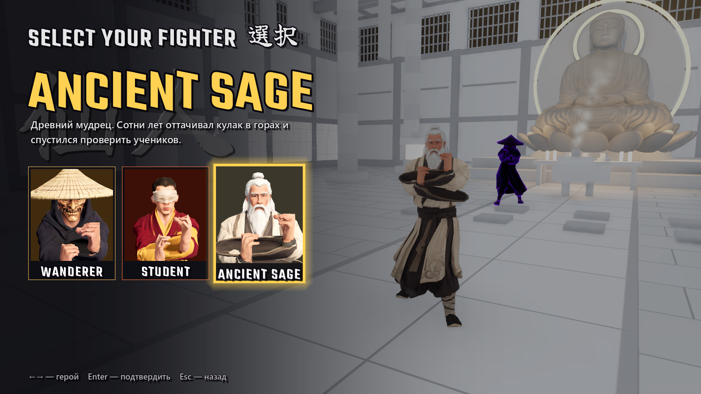
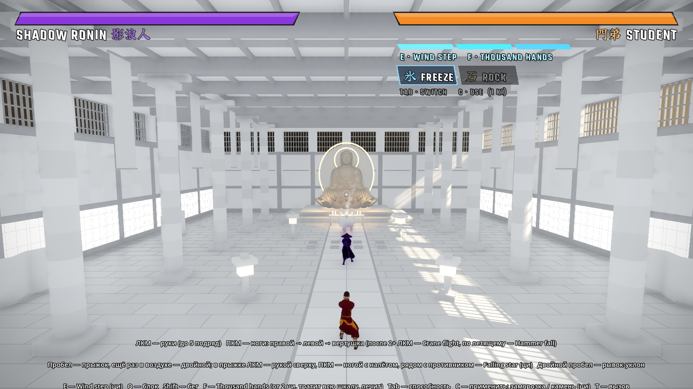

# Shadow Fist 影拳

Файтинг в стиле кунг-фу и аниме от третьего лица. Выбери героя и выходи против ронинов: они идут один за другим, пока ты
не упадёшь. Рекорд — сколько противников ты победил за один забег.

**Три героя:** странствующий ронин Wanderer 旅人, слепой ученик монастыря Student 門弟 и древний мудрец Ancient Sage 仙人.

**Две карты, и на обеих всё рушится:** круглая арена под открытым небом и буддийский храм. У храма можно проломить боковые
стены: за ними хранилище сутр и зал тренировок.

## Как запустить

1. Открой страницу **[Releases](../../releases/latest)** и скачай **`ShadowFist.exe`**.
2. Запусти его. Устанавливать ничего не нужно.
3. Windows может показать «Система Windows защитила ваш компьютер», потому что exe не подписан. Нажми **«Подробнее» →
   «Выполнить в любом случае»**.

Нужно: Windows 10 или 11 (64 бит) и видеокарта с поддержкой Vulkan (любая GeForce или Radeon последних лет).
Рекорды сохраняются в `%APPDATA%\Godot\app_userdata\Shadow Fist\`.

## Управление

| Клавиша | Что делает |
|---|---|
| WASD, мышь | ходьба и взгляд, Shift — бег |
| ЛКМ | удары руками, до 5 подряд |
| ПКМ | удары ногами: правой → левой → вертушка. После 2+ ударов рукой — Crane flight, по летящему противнику — Hammer fall |
| Пробел | прыжок; ещё раз в воздухе — двойной прыжок с сальто. В прыжке ЛКМ — удар рукой сверху, ПКМ — удар ногой с налёта, рядом с противником — Falling star (тратит ци) |
| Двойной пробел | рывок-уклон |
| E | Wind step — рывок к противнику с ударом (тратит ци) |
| Q | блок; если поставить вовремя — парирование |
| F | Thousand hands — супер-удар (нужно 2 деления ци, тратит всю шкалу, немного лечит) |
| Tab / C | выбрать / применить способность: заморозка или «каменная обезьяна» (тратит ци) |
| T | вызов |
| Колёсико | приблизить / отдалить камеру |
| Esc | пауза и выход в меню; F1 — подсказка |

Ци копится от попаданий, блоков, парирований и идеальных уклонов.

## Авторы

Игра — tensei888 (с помощью Claude). Модели героев — свои, сделаны в Tripo. Движок — [Godot](https://godotengine.org) 4.7.

- **Статуя Будды:** Yahoo! JAPAN, [«大仏（Buddha）3Dデータ»](https://www.thingiverse.com/thing:182082), лицензия
  [CC BY 4.0](https://creativecommons.org/licenses/by/4.0/). В игре изменены масштаб и сглаживание.
- **Кисть для длани Будды:** Blender Studio, Dan Ulrich и др., Human Base Meshes (CC0). В игре переделана: срезана, упрощена,
  добавлены колесо дхармы и браслеты.
- **Анимации:**
  - mocapdata.com, Eyes, JAPAN Co. Ltd. — *This motion capture data is licensed by mocapdata.com, Eyes, JAPAN Co. Ltd.
    under the Creative Commons Attribution 2.1 Japan License. http://mocapdata.com/ (C) Copyright Eyes, JAPAN Co. Ltd.
    2008-2009.* Переделанные из этих записей клипы распространяются по той же лицензии
    ([CC BY-SA 2.1 JP](https://creativecommons.org/licenses/by-sa/2.1/jp/)).
  - [CMU Graphics Lab Motion Capture Database](http://mocap.cs.cmu.edu).
  - [Quaternius](https://quaternius.com), Universal Animation Library (CC0).
  - [Motifect](https://motifect.itch.io), Martial Arts, Combat, Fantasy & Magic Motion Packs.
- **Звуки, CC BY 3.0:**
  - CGEffex, «Punch, slap, n' kick»;
  - Michel Baradari, «2 High Quality Explosions»;
  - Blender Foundation, «rock_breaking» (Yo Frankie!).
- **Звуки, CC0:** Kenney (Impact Sounds, RPG Audio, Voiceover Pack: Fighter), artisticdude, Independent.nu, rubberduck,
  StarNinjas, pyranostudios.
- **Музыка** (все треки с [OpenGameArt](https://opengameart.org)):
  - neocrey, «Last Cyber Dance» (CC BY 3.0);
  - Matthew Pablo, «Wasteland Overdrive» (CC BY 3.0);
  - nene, «Boss Battle #6 Metal» (CC0);
  - Emma_MA, «Determined Pursuit» (CC0).
- **Шрифты:** Teko (Indian Type Foundry) и Yuji Syuku (Kinuta Font Factory), SIL Open Font License.
