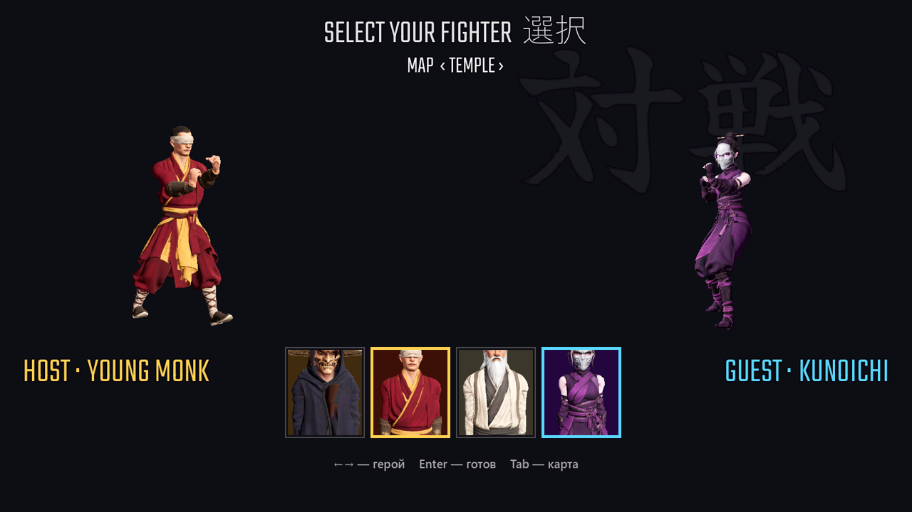
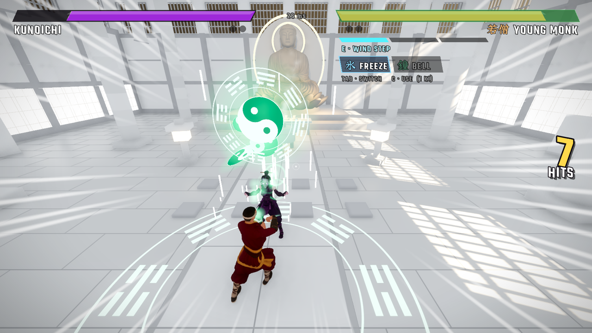
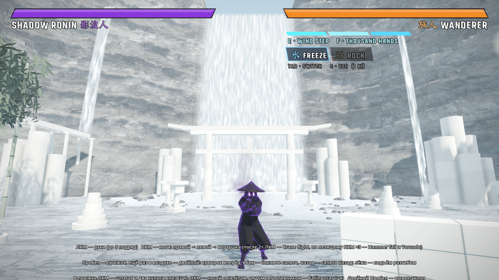
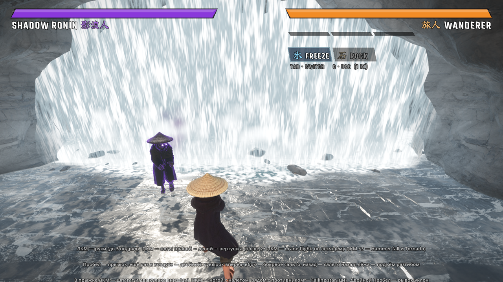

# Shadow Fist 影拳

Файтинг в стиле кунг-фу и аниме от третьего лица. Выбери героя и выходи против ронинов: они идут один за другим, пока ты
не упадёшь. Рекорд — сколько противников ты победил за один забег.

**Четыре героя:** странствующий ронин Wanderer 旅人, молодой монах с повязкой на глазах Young Monk 若僧, старый мастер с белым огнём в глазах Old Master 老師 и куноити в стальной маске Kunoichi くノ一.

**Онлайн:** сражайся с другом один на один. Создай комнату, отправь другу код, выберите бойцов и деритесь до двух побед.

**Три карты, и на всех всё рушится:** круглая арена под открытым небом, буддийский храм с проламываемыми стенами и водопад: бой на мокрой плите и по мелководью, тории, мельница, бамбук, а за завесой воды — пещера с алтарём.











## Как запустить на Windows

1. Открой страницу **[Releases](../../releases/latest)** и скачай **`ShadowFist.exe`**.
2. Запусти его. Устанавливать ничего не нужно.
3. Windows может показать «Система Windows защитила ваш компьютер», потому что exe не подписан. Нажми **«Подробнее» →
   «Выполнить в любом случае»**.

Нужно: Windows 10 или 11 (64 бит) и видеокарта с поддержкой Vulkan (любая GeForce или Radeon последних лет).
Рекорды сохраняются в `%APPDATA%\Godot\app_userdata\Shadow Fist\`.

## Как запустить на Mac

**Бета:** версия для Mac проверена только на тестовых машинах, на настоящем Mac в неё ещё не играли, поэтому возможны баги.

1. Открой страницу **[Releases](../../releases/latest)** и скачай **`ShadowFist-macOS.zip`**.
2. Распакуй архив и перетащи **Shadow Fist** в папку «Программы».
3. Приложение не заверено в Apple, поэтому при первом запуске Mac его заблокирует. Открой Терминал и выполни:

   ```
   xattr -dr com.apple.quarantine "/Applications/Shadow Fist.app"
   ```

4. Запусти игру. Если Mac всё равно не пускает: «Системные настройки» → «Конфиденциальность и безопасность» →
   внизу **«Всё равно открыть»**.

Нужно: Mac на Apple Silicon (M1 и новее) с macOS 13 или новее. Для игры нужна мышь с двумя кнопками или правый клик на трекпаде.
На Mac с процессором Intel игра не проверялась: она может не запуститься.
На Mac на карте храма нет дымки благовоний, в остальном игра та же. Играть онлайн можно между Mac и Windows.

## Как играть с другом

1. Оба скачивают игру одной версии, для Windows или для Mac.
2. Один открывает **ONLINE → Создать комнату** и отправляет другу код из пяти букв.
3. Второй открывает **ONLINE**, вводит код и нажимает **Подключиться**.
4. Выберите бойцов: ←→ — герой, Enter — готов. Карту меняет создатель комнаты клавишей Tab.
5. Бой идёт до двух побед, потом вы снова в комнате и можно сыграть ещё.

Комнату может создать любой из вас. Ничего настраивать не нужно, нужен только интернет.

Играйте с разных компьютеров: две копии игры на одном ПК могут зависнуть.

## Управление

| Клавиша | Что делает |
|---|---|
| WASD, мышь | ходьба и взгляд, Shift — бег |
| ЛКМ | удары руками, до 5 подряд |
| ПКМ | удары ногами: правой → левой → вертушка. После 2+ ударов рукой — Crane flight. По летящему противнику ПКМ ×3 — Sky kick → Hammer fall → Tornado, один раз за полёт |
| Пробел | прыжок; ещё раз в воздухе — двойной: кувырок вперёд, вбок — боковое сальто, назад — сальто назад. Лёжа — подъём разгибом. В прыжке ЛКМ — шпагат и два кулака вниз (1 деление ци), ПКМ — удар ногой с налётом |
| Двойной пробел | рывок-уклон |
| E | Wind step — рывок к противнику с ударом (тратит ци) |
| Q | блок; если поставить вовремя — парирование и ответный One Inch Punch |
| F | суперудар, у каждого героя свой (3 деления ци, 1 деление остаётся, немного лечит): Thunder Dragon, Yin Yang, Thousand Hands, Thousand Shadows |
| Tab / C | выбрать / применить способность: заморозка Frost seal (1 деление ци) или свой скилл героя (2 деления): шляпа бумерангом, колокол, точка смерти, сюрикен |
| T | вызов |
| Колёсико | приблизить / отдалить камеру |
| Esc | пауза и выход в меню; F1 — подсказка |

Ци копится от попаданий, блоков, парирований и идеальных уклонов. Все кнопки можно переназначить в меню, пункт CONTROLS.

## Авторы

Игра — tensei888 (с помощью Claude). Модели героев — свои, сделаны в Tripo. Движок — [Godot](https://godotengine.org) 4.7.

- **Статуя Будды:** Yahoo! JAPAN, [«大仏（Buddha）3Dデータ»](https://www.thingiverse.com/thing:182082), лицензия
  [CC BY 4.0](https://creativecommons.org/licenses/by/4.0/). В игре изменены масштаб и сглаживание.
- **Кисть для длани Будды:** Blender Studio, Dan Ulrich и др., Human Base Meshes (CC0). В игре переделана: срезана, упрощена,
  добавлены колесо дхармы и браслеты.
- **Голова дракона:** king arthur (jimjimjimmyjim), [Asian-style dragon](https://archive.org/details/thingiverse-4314911), лицензия
  [CC BY 4.0](https://creativecommons.org/licenses/by/4.0/). В игре вырезана из модели и упрощена.
- **Текстура камня на водопаде:** [Poly Haven](https://polyhaven.com/a/cliff_side), cliff_side (CC0).
- **Ледяные кристаллы:** ipoly3d, [LowPoly Crystals Pack](https://opengameart.org/content/lowpoly-crystals-pack) (CC0).
- **Анимации:**
  - mocapdata.com, Eyes, JAPAN Co. Ltd. — *This motion capture data is licensed by mocapdata.com, Eyes, JAPAN Co. Ltd.
    under the Creative Commons Attribution 2.1 Japan License. http://mocapdata.com/ (C) Copyright Eyes, JAPAN Co. Ltd.
    2008-2009.* Переделанные из этих записей клипы распространяются по той же лицензии
    ([CC BY-SA 2.1 JP](https://creativecommons.org/licenses/by-sa/2.1/jp/)).
  - [CMU Graphics Lab Motion Capture Database](http://mocap.cs.cmu.edu), в том числе запись тайцзи.
  - [Quaternius](https://quaternius.com), Universal Animation Library (CC0).
  - [Motifect](https://motifect.itch.io), Martial Arts, Combat, Fantasy & Magic Motion Packs.
- **Звуки, CC BY 3.0:**
  - CGEffex, «Punch, slap, n' kick»;
  - Michel Baradari, «2 High Quality Explosions»;
  - Blender Foundation, «rock_breaking» (Yo Frankie!).
- **Звуки, CC0:** Kenney (Impact Sounds, RPG Audio, Voiceover Pack: Fighter), artisticdude, Independent.nu, rubberduck,
  StarNinjas, pyranostudios.
- **Музыка** (все треки с [OpenGameArt](https://opengameart.org)):
  - neocrey, «Last Cyber Dance» (CC BY 3.0);
  - Matthew Pablo, «Wasteland Overdrive» (CC BY 3.0);
  - nene, «Boss Battle #6 Metal» (CC0);
  - Emma_MA, «Determined Pursuit» (CC0).
- **Шрифты:** Teko (Indian Type Foundry) и Yuji Syuku (Kinuta Font Factory), SIL Open Font License.
